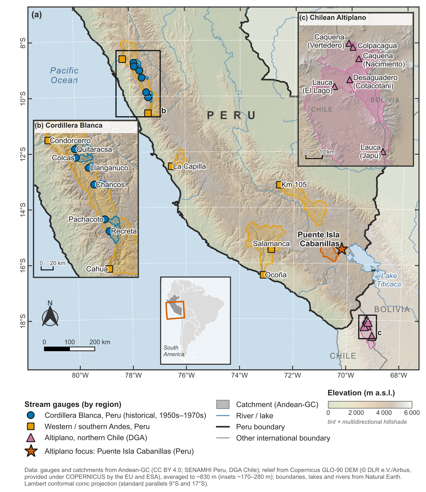
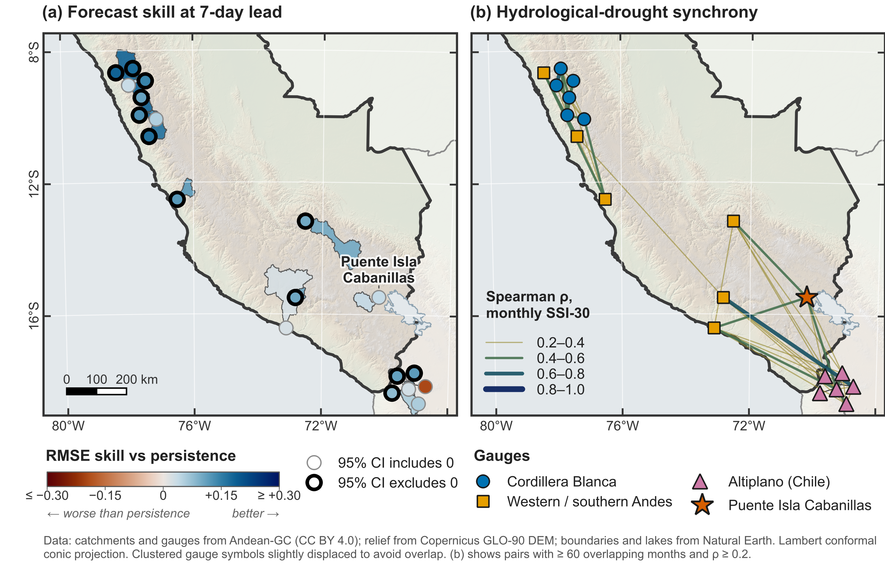
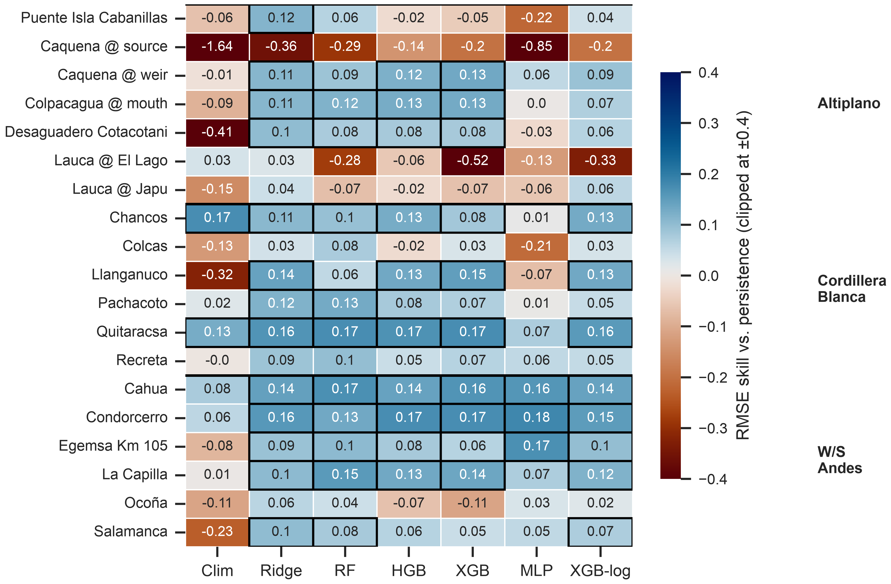

# When Machine Learning Beats Persistence

**A leakage-free streamflow and drought benchmark for the Tropical Andes**

[](https://cmt3.research.microsoft.com/ICICCDS2027)
[](https://doi.org/10.5281/zenodo.18035801)
[](LICENSE)
[](https://www.python.org/)
[](https://qgis.org/)
[](03-codigo/tests/test_pipeline.py)
[](#key-results)

**Conference proceedings contribution** (not a journal article), submitted to the *International Conference on Intelligent Computing, Communication and Data Science* (**ICICCDS 2027**) and prepared in the Springer proceedings format (SVMult). This repository contains the complete code, data extracts and results behind the contribution.

---

## Overview

Daily streamflow is strongly autocorrelated, so **persistence** ($\hat Q_{t+h}=Q_t$) is a hard baseline. Small implementation details can quietly hand an advantage to either side. This repository is a **transparent, reproducible benchmark** for 1-, 3- and 7-day streamflow and hydrological-drought forecasting at **19 long-record Andean gauges** in three regions:

| Region | Gauges | Character |
| --- | :---: | --- |
| **Altiplano** | 7 | Puente Isla Cabanillas (Peru, Lake Titicaca basin) and the Lauca/Caquena headwaters (Chile) |
| **Cordillera Blanca** | 6 | Glacier-fed catchments, 1952–1974 records |
| **Western / southern Andes** | 6 | Long records draining to the arid Pacific coast |

Every evaluation choice is explicit and tested:

1. **Calendar-continuous daily index.** A lag of *k* days is exactly *k* days, even across multi-year gaps.
2. **Same information at issue time.** Learners and persistence both see $Q_t$.
3. **Chronological 70/15/15 splits** with an *h*-day embargo between blocks.
4. **Validation-only selection** of hyper-parameters and target form (level vs. change).
5. **Uncertainty.** Moving-block bootstrap 95% CIs and Diebold–Mariano tests against persistence.
6. **Drought as its own target.** Variable-threshold drought days scored with POD, FAR and CSI, plus a nonparametric SSI-30.
7. **Spatial statistics.** A drought-synchrony correlogram, Moran's *I* of skill and catchment-attribute drivers, with maps rendered in **QGIS**.

<p align="center">
  
  <br><sub><b>Figure 1.</b> The 19 gauges and their Andean-GC catchments (QGIS; Copernicus GLO-90 relief). Insets show the Cordillera Blanca and Chilean Altiplano clusters.</sub>
</p>

---

## Key results

<table>
<tr><td valign="top" width="52%">

**Skill against persistence**, using the learner selected on validation (all 19 gauges)

| Lead | Gauges with skill > 0 | 95% CI > 0 | Median skill |
|:---:|:---:|:---:|:---:|
| 1 day | 15 / 19 | 9 | 0.046 |
| 3 days | 15 / 19 | 10 | 0.080 |
| 7 days | **18 / 19** | **12** | **0.101** |

Walk-forward check: **53 / 57** gauge–fold combinations have positive 7-day Ridge skill (median 0.103).

</td><td valign="top" width="48%">

**Focus gauge: Puente Isla Cabanillas** (test period 2021–2024)

| Lead | Method | NSE | Skill [95% CI] |
|:---:|---|:---:|:---:|
| 1 d | Persistence | 0.902 | — |
| 1 d | Random forest | **0.922** | **0.110** [0.064, 0.144] |
| 7 d | Persistence | 0.461 | — |
| 7 d | Ridge (change) | **0.578** | **0.115** [0.028, 0.208] |

An earlier version of this pipeline was leaky and reported that persistence wins at one day. Under the corrected protocol, that conclusion **reverses**.

</td></tr>
</table>

- **Drought is a different target.** RMSE gains do **not** improve detection of drought days. At 7 days, median CSI is **0.43 for persistence vs. 0.30 for the learners**: the learners raise fewer false alarms but miss more drought days.
- **More data did not help.** Adding MERRA-2 precipitation and GloFAS v4 discharge changes the median skill by −0.004 (Ridge) and −0.008 (XGBoost). Raw GloFAS has a median NSE of −0.10 at these catchments.
- **Spatial structure.** Hydrological drought decorrelates over **≈ 582 km** (95% CI 330–1069 km). Same-region pairs correlate at median ρ = 0.28, cross-region pairs at 0.09.
- **Skill follows regime, not location.** Moran's *I* = 0.018 (p = 0.37), so skill is not spatially clustered. Its strongest correlate is snow fraction (ρ = −0.57, p = 0.010; Holm-adjusted 0.071).

<p align="center">
  
  <br><sub><b>Figure 6.</b> (a) 7-day skill by catchment (bold outline: 95% CI above 0). (b) Hydrological-drought synchrony network (QGIS).</sub>
</p>

<p align="center">
  
  <br><sub><b>Figure 3.</b> 7-day skill for every gauge and method. Boxed cells: bootstrap CI above 0.</sub>
</p>

---

## Repository structure

```
streamflow-drought-altiplano/
├── 00-gestion/                      # Project log, decisions, plan (Spanish)
├── 01-articulo/
│   ├── caudal-sequia-altiplano_8p.pdf  # Proceedings version (8 pages, submitted)
│   ├── caudal-sequia-altiplano.pdf     # Extended version (16 pages)
│   ├── 00-abstract.md               # Abstract (generated from the manuscript)
│   └── manuscrito/                  # Springer SVMult source
│       ├── caudal-sequia-altiplano_8p.tex                          # 8-page proceedings version
│       ├── caudal-sequia-altiplano.tex, results.tex, backmatter.tex  # extended version
│       ├── cifras.tex, tab_*.tex    # AUTO-GENERATED numbers and tables (make_cifras.py)
│       ├── references.bib           # 58 cited references, DOIs verified on Crossref/DataCite
│       └── references_verification.md
├── 02-datos/
│   ├── fuentes/INVENTARIO.md        # Provenance, URLs, licences
│   ├── crudos/stations/             # 19 Andean-GC gauge extracts + benchmark_stations.csv
│   ├── crudos/clima/                # ERA5 · NASA POWER (MERRA-2) · GloFAS v4 caches + manifests
│   ├── crudos/andean-gc/            # Metadata + catchment polygons of the 19 gauges
│   └── procesados/                  # Nonparametric SSI-30, focus-gauge forecasts
├── 03-codigo/
│   ├── config.py                    # All settings (splits, leads, features, bootstrap)
│   ├── extract_stations.py          # Gauge selection from Andean-GC
│   ├── fetch_data.py                # ERA5 / POWER / GloFAS download (rate-limit safe, resumable)
│   ├── run_experiment.py            # Leakage-free benchmark (parallel over gauges)
│   ├── metrics_utils.py             # NSE, KGE, skill, block bootstrap, Diebold–Mariano, CSI
│   ├── plots.py                     # Figures (seaborn + Crameri colour maps, 600 dpi)
│   ├── spatial_analysis.py          # Correlogram, Moran's I, skill drivers
│   ├── make_cifras.py               # Writes every number of the paper
│   ├── maps/                        # PyQGIS map scripts + .qgz project
│   └── tests/test_pipeline.py       # Leakage, calendar, embargo and metric tests
└── 04-resultados/
    ├── figuras/                     # fig00–fig09 (PNG 600 dpi + PDF)
    └── tablas/                      # Metrics, walk-forward, fusion, spatial statistics
```

---

## Installation

```bash
python3 -m venv .venv
source .venv/bin/activate
pip install --upgrade pip
pip install -r requirements.txt
python -m pytest 03-codigo/tests -q     # 7 passed
```

The maps need **QGIS 4.2**. The scripts relaunch themselves with the Python bundled in QGIS; see their docstrings.

---

## Reproducing the results

| # | Command | What it does | Time |
|---|---|---|---|
| 1 | `python 03-codigo/extract_stations.py` | Selects the 19 gauges from the Andean-GC QC CSV (download from Zenodo first) | < 1 min |
| 2 | `python 03-codigo/fetch_data.py` | ERA5, NASA POWER and GloFAS at each catchment; resumable, rate-limit safe | 30–60 min |
| 3 | `python 03-codigo/run_experiment.py` | 19 gauges × 3 leads × 8 methods, bootstrap, DM, drought, fusion, walk-forward | ≈ 4 min (10 cores) |
| 4 | `python 03-codigo/plots.py` | Result figures | < 1 min |
| 5 | `python 03-codigo/spatial_analysis.py` | Correlogram, Moran's *I*, skill drivers | ≈ 1 min |
| 6 | `python 03-codigo/make_cifras.py` | Writes `cifras.tex` and `tab_*.tex` for the manuscript | seconds |
| 7 | `python 03-codigo/maps/make_fig00_qgis.py`<br>`python 03-codigo/maps/make_fig08_spatial_qgis.py` | QGIS maps | ≈ 1 min each |
| 8 | `pdflatex` → `bibtex` → `pdflatex` ×2 on `caudal-sequia-altiplano_8p.tex` (or the extended `caudal-sequia-altiplano.tex`) | Builds the paper | seconds |

Set `export MPLBACKEND=Agg` on headless machines. Steps 1–2 are needed only to rebuild the data from scratch, because the extracts and caches are already in the repository.

---

## Authors

**Richar Andre Vilca-Solorzano**\* ([0009-0003-2385-5263](https://orcid.org/0009-0003-2385-5263)) · **Dina Maribel Yana-Yucra** ([0009-0003-6218-2735](https://orcid.org/0009-0003-6218-2735)) · **Renato Quispe-Vargas** ([0009-0005-2367-7852](https://orcid.org/0009-0005-2367-7852))
Faculty of Statistical and Computer Engineering, Universidad Nacional del Altiplano (UNAP), Puno, Peru.
<sub>\* Corresponding author: <75521963@est.unap.edu.pe></sub>

R. A. Vilca-Solorzano conceived the study, developed the software and analysis, and wrote the manuscript. D. M. Yana-Yucra contributed to the methodology, analysis and writing. R. Quispe-Vargas validated the results.

---

## Citation

```bibtex
@inproceedings{VilcaSolorzano2027Andes,
  author    = {Vilca-Solorzano, Richar Andre and Yana-Yucra, Dina Maribel and Quispe-Vargas, Renato},
  title     = {When Machine Learning Beats Persistence: A Leakage-Free Streamflow and Drought
               Benchmark for the Tropical Andes},
  booktitle = {International Conference on Intelligent Computing, Communication and Data Science (ICICCDS 2027)},
  year      = {2027},
  note      = {Conference proceedings contribution, submitted},
  url       = {https://github.com/Andre031222/streamflow-drought-altiplano}
}
```

---

## Data & code availability

| Source | Use | Licence |
|---|---|---|
| [Andean-GC](https://doi.org/10.5281/zenodo.18035801) (Aguayo et al.) | Daily QC discharge, catchment polygons and attributes | CC BY 4.0 |
| ERA5 (Copernicus) via [Open-Meteo](https://open-meteo.com/) | Catchment precipitation and temperature | CC BY 4.0 |
| [NASA POWER](https://power.larc.nasa.gov/) (MERRA-2 `PRECTOTCORR`) | Second precipitation source | Public |
| GloFAS v4 (Copernicus EMS) via Open-Meteo Flood API | Simulated discharge (fusion and physical reference) | CC BY 4.0 |
| Copernicus GLO-90 DEM, Natural Earth | Map relief and base layers | Copernicus DEM licence / public domain |

Full provenance is in [`02-datos/fuentes/INVENTARIO.md`](02-datos/fuentes/INVENTARIO.md). Code is released under the [MIT licence](LICENSE). The forecasts are research benchmarks, not operational warnings, and do not replace SENAMHI, DGA or other national services.
